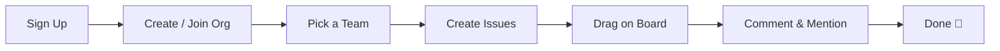
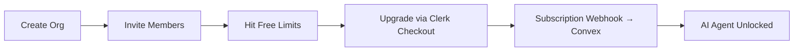
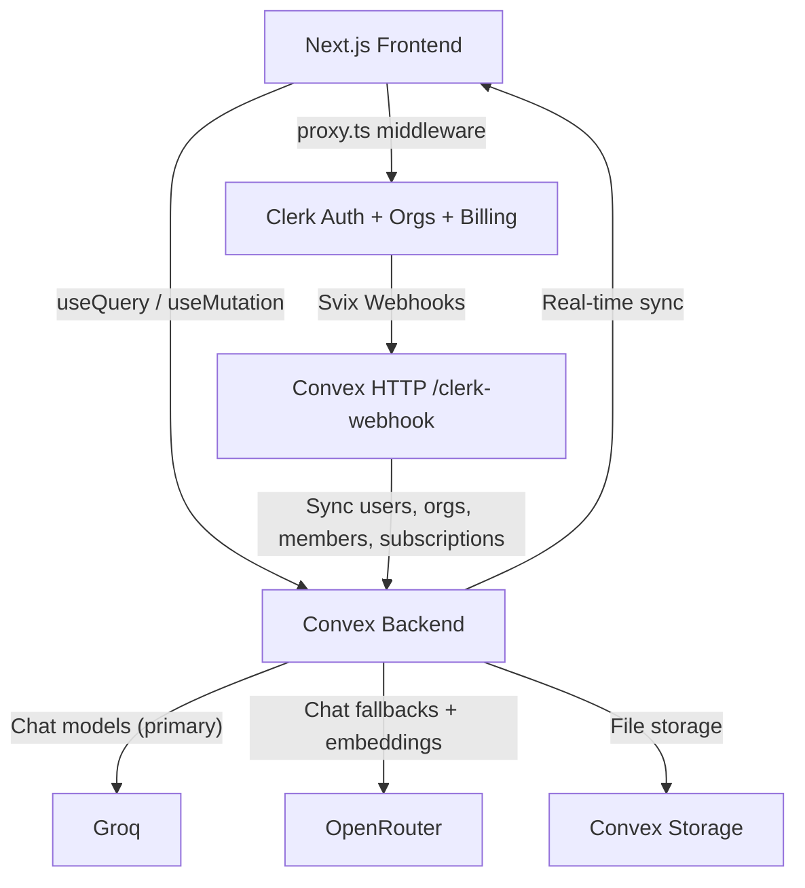
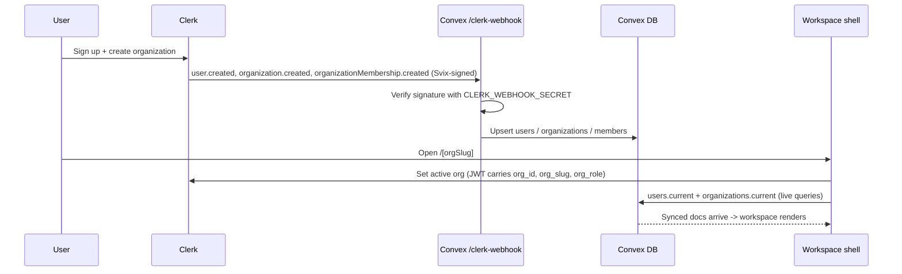
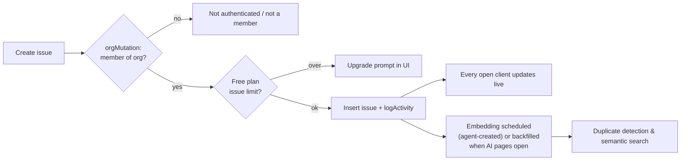
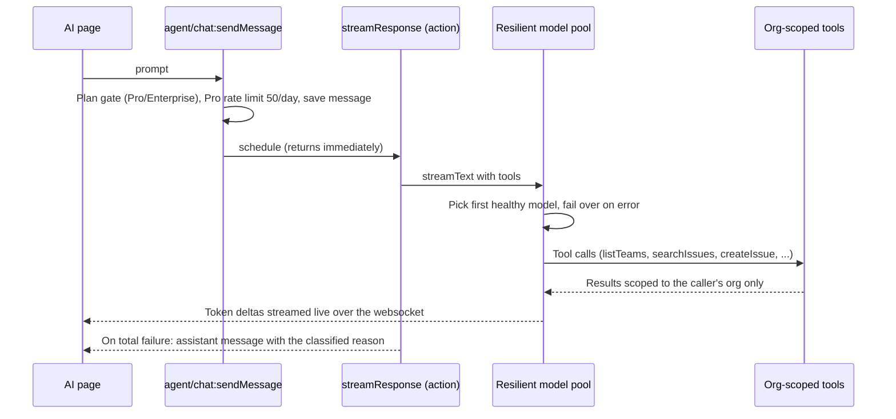
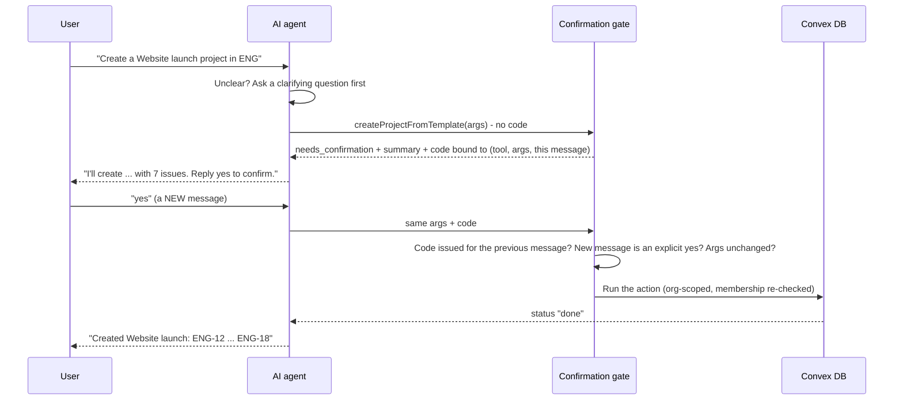
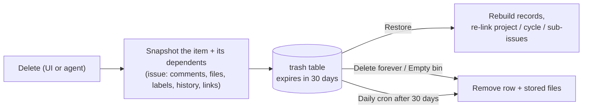
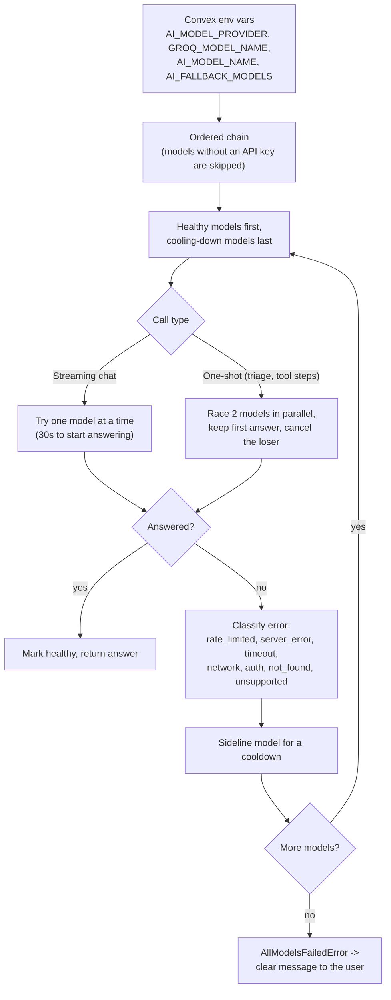
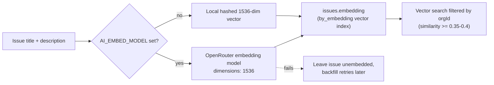

# DevTrack, Linear-Style Project Management for Teams

[](LICENSE)
[](https://bun.sh)
[](https://nextjs.org/)
[](https://convex.dev)
[](https://clerk.com)
[](https://tailwindcss.com/)
[](https://www.typescriptlang.org/)

**Author & maintainer:** [Mowlid](https://devmowlid.vercel.app/) · [GitHub @Mawlid1431](https://github.com/Mawlid1431)

> DevTrack is designed, built, and maintained by Mowlid. Issues, ideas, and pull requests are welcome, see [CONTRIBUTING.md](CONTRIBUTING.md). If DevTrack helps you, a ⭐ helps others find it.

> **⚠️ Disclaimer:** This project is **not affiliated with, endorsed by, or connected to Linear, Jira, Asana, or any other project management platform**. All organization names, issues, and user data in the seed files are entirely fictional. Third-party service names (Clerk, Convex, Vercel, Next.js, Groq, Tailwind CSS, etc.) are trademarks of their respective owners and are used here solely to describe the technologies used in this project.

A full-stack, real-time **Linear clone**: a B2B multi-tenant SaaS issue tracker where teams manage issues on Kanban boards, plan projects and cycles, collaborate with comments and mentions, and ship faster with a built-in **AI agent** that knows their entire workspace.

> **Who is this for?**
> Anyone who wants to learn how to build a production-grade, multi-tenant B2B SaaS using modern tools, or anyone looking for a serious starter template for their own project management product.

> **What makes it different?**
> Every update is **real-time** (no page refreshes). Auth, organizations, AND billing are handled by **Clerk**: no Stripe wiring required. The backend is powered by **Convex**: a reactive database that pushes changes to every connected client instantly. And there's a fully working **AI agent** (Convex Agent + [Groq](https://groq.com/)) with org-scoped tools, triage assist, duplicate detection, and rate limiting.

> **Under the hood**
> Bun · Next.js 16 App Router · Convex reactive backend · Clerk auth + organizations + B2B billing · Convex Agent + Groq · @dnd-kit drag & drop · shadcn/ui · Tailwind CSS v4 · TypeScript strict mode

## 👇🏼 DO THIS Before You Get Started

You'll need free accounts on these services to run the app. **Set them up before cloning:**

| Service                 | What it does                                                 | Sign up                                                                  |
| ----------------------- | ------------------------------------------------------------ | ------------------------------------------------------------------------ |
| **Clerk**               | Authentication, organizations, and B2B subscription billing  | [Create a free Clerk account →](https://clerk.com)                         |
| **Convex**              | Real-time backend, database, vector search, and file storage | [Create a free Convex account →](https://convex.dev)                       |
| **Groq**                | Powers the AI agent, triage assist, and duplicate detection  | [Get a free API key →](https://groq.com/)                                 |
| **Vercel** _(optional)_ | Deployment & hosting                                         | [vercel.com →](https://vercel.com)                                       |

## 🤔 What Is This App?

Think of DevTrack as **your own mini Linear**: a modern issue tracker built from scratch as a learning project, with the same keyboard-first, dense, dark-mode-default aesthetic.

It's a multi-tenant workspace app. Every organization gets its own isolated workspace, and members collaborate inside it in real time:

**As a team member**, you can:

- Create and manage issues with statuses, priorities, assignees, estimates, due dates, and labels
- Drag issues across a **Kanban board** that updates for everyone instantly
- Search the entire workspace with full-text search and save filtered views
- Comment on issues with **@mentions**, attach files, link related issues, and break work into sub-issues
- See who else is viewing an issue with **live presence**
- Fly through everything with a **command palette (⌘K)** and single-key shortcuts

**As a workspace admin**, you can:

- Organize work into **teams** (each with its own issue prefix like `ENG-123`), **projects**, and **cycles** (sprints)
- Invite members and manage roles
- Upgrade the workspace and manage billing, checkout, plan changes, and invoices all handled by Clerk
- Unlock the **AI agent** on paid plans

**The AI agent** (Pro/Enterprise) can:

- Create, update, and search issues for you using natural language
- Summarize cycles, report project status, and generate standups
- Detect duplicate issues using vector embeddings
- Triage new issues automatically

**Popular use cases:**

- 🎓 **Portfolio project**: show off a real multi-tenant B2B SaaS to employers
- 🚀 **SaaS starter**: fork it and turn it into your own productivity tool
- 📚 **Learn the modern stack**: see exactly how Convex, Clerk billing, and AI agents fit together

## 👨‍💻 About the Developer

**[Mowlid](https://devmowlid.vercel.app/)** (Dev Mowlid Haibe) is the creator and maintainer of DevTrack.

| | |
|---|---|
| **Portfolio** | [devmowlid.vercel.app](https://devmowlid.vercel.app/) |
| **GitHub** | [@Mawlid1431](https://github.com/Mawlid1431) |
| **License** | [MIT](LICENSE) |

DevTrack was created by Mowlid. Third-party packages (Convex, Clerk, Next.js, etc.) are dependencies. Community contributions are credited in the commit history.

## ✨ Features

### Issues & Boards

- 📝 **Full issue tracking**: Statuses (Backlog → Todo → In Progress → In Review → Done / Canceled), five priority levels, assignees, estimates, due dates, and color-coded labels
- 🔢 **Team-scoped issue keys**: Every team gets a prefix, so issues read like `ENG-42` or `DESIGN-7`
- 🗂️ **Kanban board**: Drag & drop with @dnd-kit and fractional sort ordering; every move syncs to all clients instantly
- 🔍 **Full-text search**: Convex search indexes across issue titles and descriptions, scoped to your workspace
- 💾 **Saved views**: Save filter combinations as personal or shared views
- ⌨️ **Command palette**: ⌘K for everything, plus single-key shortcuts (Linear style)

### Collaboration

- 💬 **Comments with @mentions**: Mention teammates by name in issue discussions
- 📜 **Activity feed**: Every status change, assignment, and label is logged and rendered on the issue
- 🌳 **Sub-issues & relations**: Break work down with parent/child issues; link issues as _blocks_, _blocked by_, _related_, or _duplicate of_
- 📎 **Attachments**: Upload files to issues using Convex file storage
- 🟢 **Live presence**: See who's viewing the same issue in real time

### Projects & Cycles

- 📊 **Projects**: Group issues across teams with statuses, leads, target dates, and live progress (issue counts by status)
- 🔄 **Cycles**: Time-boxed sprints per team, auto-numbered, with current-cycle tracking
- 🏗️ **Multi-team workspaces**: Unlimited teams per organization, each with its own board and cycles
- 🧩 **Templates**: Project templates (a project + starter issues) and workspace templates (teams, labels, first cycle). Four built-in project templates, three built-in workspace templates, plus your own custom ones (private to the workspace)
- ♻️ **Recycle bin**: Everything you delete (issues with their comments and files, projects, cycles, comments, attachments, saved views, templates) goes to the bin and can be restored for 30 days; then it's purged automatically

### AI Agent (Pro & Enterprise)

- 🤖 **Workspace-aware chat**: A Convex Agent assistant with org-scoped tools: create/update/search issues, summarize cycles, report project status, list members
- 🔀 **Multi-model, multi-provider**: One shared model pool (Groq + OpenRouter) serves every AI feature: chat, triage and duplicate detection
- ⚡ **Parallel + failover**: One-shot calls race the two best models and keep the first answer; streaming chat fails over instantly. Rate-limited, down, retired or misconfigured models are classified and sidelined for a cooldown
- 🩹 **Clear failure messages**: When every model is unavailable, users are told why (usage limit, provider outage, or misconfiguration) instead of a generic error
- 🛠️ **Full workspace management**: On request the agent creates and deletes issues and projects, creates projects from templates, saves new templates, sets up the workspace from a workspace template, creates brand-new workspaces, and restores items from the recycle bin
- ✋ **Asks before it acts**: The agent asks clarifying questions when a request is vague, and every create/delete is confirmation-gated on the server: nothing happens until you reply "yes" in a new message
- 🗂️ **Sorts and prioritizes your tasks**: "Prioritize my tasks" / "put ENG-4 first" sets priorities and the exact order on your lists and boards
- 🩺 **Live diagnostics**: `npx convex run agent/diagnostics:checkModels` tests every model in parallel and reports a plain-language reason for any that isn't ready
- 🧠 **Duplicate detection**: Issues are embedded (1536-dim vectors) on create; the agent finds similar issues before you file the same bug twice
- 🩺 **Triage assist**: AI-suggested priority and labels for new issues
- 📋 **Standup & cycle reports**: Generate summaries of what shipped and what's blocked
- ⏱️ **Rate limiting**: 50 messages/user/day on Pro, unlimited on Enterprise (`@convex-dev/rate-limiter`)

### Billing & Multi-Tenancy

- 🏢 **Clerk Organizations**: Every workspace is a Clerk organization; memberships and roles sync to Convex via webhooks
- 💳 **Clerk B2B Billing**: Custom-designed pricing page with checkout, plan management, and invoices handled entirely by Clerk (no Stripe integration to write)
- 🔐 **Plan gating, done right**: UI gates with `has({ plan })` / `has({ feature })` are cosmetic; Convex mutations are the real enforcement
- 🚦 **Free-tier limits**: Seats, projects, and issue caps enforced server-side with friendly upgrade prompts in the UI

### Pricing Tiers

|                      | Free | Pro ($20/mo)                           | Enterprise ($99/mo) |
| -------------------- | ---- | -------------------------------------- | ------------------- |
| **Members**          | 3    | 10 (seat-based, +$10/seat after first) | Unlimited           |
| **Projects**         | 2    | Unlimited                              | Unlimited           |
| **Issues**           | 100  | Unlimited                              | Unlimited           |
| **AI agent**         | None | ✅ 50 msgs/user/day                    | ✅ Unlimited        |
| **Priority support** | None | None | ✅                  |

_Annual billing: Pro $16/mo-equivalent, Enterprise $79/mo-equivalent._

### Technical Features (The Smart Stuff)

- ⚛️ **Next.js 16 App Router**: Route groups for marketing vs. app shell, dynamic `[orgSlug]` workspace routes, `proxy.ts` middleware
- 🔄 **Convex reactive backend**: No polling, no refetching. Queries are live subscriptions
- 🛡️ **Custom function wrappers**: `orgQuery` / `orgMutation` resolve the user, org, and membership from the Clerk JWT and enforce org scoping on every single function (Convex's answer to RLS)
- 🔐 **Clerk webhooks → Convex**: Users, organizations, memberships, and subscriptions sync via Svix-verified webhooks; Clerk stays the source of truth
- 🧩 **Convex components**: `@convex-dev/agent` (AI), `@convex-dev/presence` (live presence), `@convex-dev/rate-limiter` (AI quotas)
- 🔎 **Search + vector indexes**: Full-text search indexes and a 1536-dimension vector index, both defined in the schema
- 🖱️ **@dnd-kit drag & drop**: With fractional `sortOrder` ranking so reorders are O(1) writes
- 🧩 **shadcn/ui + Tailwind CSS v4**: Linear-style density, dark theme by default, light mode via `next-themes`
- ✅ **Validators everywhere**: Every public Convex function validates args AND return values
- 📱🖥️ **Responsive from 320px phones to 4K and curved ultrawides**: Drawer navigation on phones, stacked panels on tablets, and height-aware UI scaling on 1440p, ultrawide and 4K screens (see [Responsive Design](#-responsive-design))

## 🔄 How It Works

### Team Member Flow



### Admin / Billing Flow



### Architecture Overview



### Sign-Up & Sync Workflow

Clerk is the source of truth; Convex holds a mirror that the app reads in real time.



### Issue Lifecycle Workflow



### AI Agent Request Workflow



### Agent Management & Confirmation Workflow

Creating or deleting anything through the agent (issues, projects, templates, workspace setup, new workspaces) goes through a server-enforced confirmation gate in `convex/agent/confirm.ts`.



- The model can't confirm on its own: the code is only accepted after a newer user message that says yes ("yes", "ok", "go ahead", "haa"…), and "no"/"wait"/"cancel" always blocks it.
- Small edits (priority, status, sorting, assignment, titles) run immediately and are reported back.
- Deletes never destroy data: they go to the recycle bin.

### Recycle Bin Workflow



| Who | Sees in the bin | Can restore / delete forever | Can empty the bin |
| --- | --- | --- | --- |
| Member | Only what they deleted | Their own items | None |
| Admin | Everything deleted in the workspace | Any item in the workspace | ✅ |
| Other workspaces | Nothing | Nothing | None |

Restore keeps the original issue number when it's still free, re-attaches sub-issues, skips links to things that were deleted meanwhile, and respects free-plan limits.

### Data Privacy

- **Per workspace:** every table row carries `orgId`, and every function goes through `orgQuery` / `orgMutation`, which verify the caller is a member of the active workspace. Nothing (issues, templates, recycle bin, AI threads) is visible across workspaces.
- **Per user:** AI conversations are owned by one user in one workspace; recycle-bin entries are visible only to the person who deleted them (and workspace admins).
- **Agent scoping:** the agent's tools receive the workspace and user from the authenticated session, never from the model, and re-check membership (and admin role for workspace setup) on every call.

### Model Selection and Failover Workflow

Every AI feature (chat, triage assist, duplicate detection) goes through the same pool in `convex/agent/models.ts`.



| Failure kind | Typical cause | Cooldown | What the user sees if every model fails this way |
| --- | --- | --- | --- |
| `rate_limited` | HTTP 429/402: free-tier limit or quota | 60s, or the provider's `Retry-After` | "All AI models have reached their usage limit for the moment…" |
| `server_error`, `timeout`, `network` | Provider outage, overload, or slow start | 15–30s | "The AI providers are not responding right now…" |
| `auth`, `not_found`, `unsupported` | Bad API key, retired model, or not a tool-calling chat model | 10 min | "The AI models are misconfigured… run `agent/diagnostics:checkModels`" |
| mixed | A combination of the above | per kind | "Every AI model is unavailable right now…" |

Cooldowns live in memory per warm Convex worker: a fast path, never needed for correctness. A sidelined model is still tried last, so a request only fails when no model at all can answer.

### Embeddings & Duplicate Detection Workflow



Only one embedding model is active at a time: vectors from different models can't be compared. After changing `AI_EMBED_MODEL`, run `npx convex run agent/embeddings:reembedAllIssues`.

## 📱 Responsive Design

DevTrack is built to fit everything from a 320px phone to a 4K monitor or a curved ultrawide.

| Screen | Width × height | What changes |
| --- | --- | --- |
| Small phones | 320–374px | Marketing nav drops its Pricing link (still in the hero); 16px side padding |
| Phones | 375–767px | Workspace sidebar becomes a slide-in drawer from a top bar; AI conversations open in a drawer; settings tabs scroll sideways; board/list headers show icons only |
| Tablets | 768–1023px | Fixed sidebar returns; issue and project property panels stack under the content |
| Laptops, 21"–24" monitors | 1024–2559px | Full desktop layout at 16px base size; readable content is capped in width |
| 27"–32" 1440p, 34"–49" curved ultrawides | ≥ 2560 wide **and** ≥ 1300 tall | UI scales to 18px base |
| 3200×1800-class panels | ≥ 3200 × 1700 | 20px base |
| 4K at 100% OS scaling, 5K2K ultrawides | ≥ 3840 × 2000 | 24px base |
| 5K / 6K, 8K | ≥ 5120 × 2800, ≥ 7680 × 4000 | 28px, 32px base |

How it works:

- **Everything is in `rem`**, so one root font size in `app/globals.css` scales the whole UI evenly. Text that used fixed pixel sizes was converted to the equivalent `rem`.
- **Height-aware tiers:** a curved ultrawide is very wide but only 1440px tall, so it scales like a 1440p monitor instead of being blown up like 4K. Readable content stays centred with a capped width.
- **OS scaling is respected:** at 150% or 200% Windows/macOS scaling the browser already reports a smaller CSS size, so the large tiers only apply when text would otherwise be tiny.
- **No sideways scrolling:** the page body clips horizontal overflow, and decorative glows are clipped on marketing pages. Board columns and filter bars scroll inside their own rows.
- **Mobile navigation:** `components/shell/mobile-nav.tsx` reuses the same `AppSidebar` inside a drawer that closes on navigation or when the screen grows past 768px.

The landing, pricing and sign-in pages were measured with zero horizontal overflow at 320×568, 375×812, 768×1024, 1280×800, 1920×1080, 2560×1440, 3440×1440, 5120×1440 and 3840×2160. The signed-in workspace layouts follow the same breakpoints.

## 🏁 Getting Started

### Prerequisites

- **[Bun](https://bun.sh)** 1.3+ (package manager & runtime)
- **Node.js** 18+ (required by Next.js / Convex tooling)
- A **[Clerk](https://clerk.com)** account
- A **[Convex](https://convex.dev)** account
- A **[Groq](https://groq.com/)** API key (for the AI agent)

### 1. Clone the repository

```bash
git clone https://github.com/Mawlid1431/devtrack.git
cd devtrack
```

> Replace the repo name if yours differs on [GitHub @Mawlid1431](https://github.com/Mawlid1431).

### 2. Install dependencies

```bash
bun install
```

### 3. Set up environment variables

Create a `.env.local` file in the project root:

```env
# Clerk, https://clerk.com
NEXT_PUBLIC_CLERK_PUBLISHABLE_KEY=pk_test_...
CLERK_SECRET_KEY=sk_test_...
NEXT_PUBLIC_CLERK_FRONTEND_API_URL=https://your-instance.clerk.accounts.dev
CLERK_FRONTEND_API_URL=https://your-instance.clerk.accounts.dev   # pushed to Convex
CLERK_WEBHOOK_SECRET=whsec_...                                     # pushed to Convex (step 6)

# Clerk routing
NEXT_PUBLIC_CLERK_SIGN_IN_URL=/sign-in
NEXT_PUBLIC_CLERK_SIGN_UP_URL=/sign-up
NEXT_PUBLIC_CLERK_SIGN_IN_FALLBACK_REDIRECT_URL=/onboarding
NEXT_PUBLIC_CLERK_SIGN_UP_FALLBACK_REDIRECT_URL=/onboarding

# Convex, https://convex.dev
CONVEX_DEPLOYMENT=dev:your-deployment
NEXT_PUBLIC_CONVEX_URL=https://your-deployment.convex.cloud
NEXT_PUBLIC_CONVEX_SITE_URL=https://your-deployment.convex.site

# AI, read by Convex functions, pushed with scripts/setup-convex-env.ts
GROQ_API_KEY=gsk_...
OPENROUTER_API_KEY=sk-or-v1-...
AI_MODEL_PROVIDER=groq
GROQ_MODEL_NAME=openai/gpt-oss-120b
AI_MODEL_NAME=google/gemma-4-31b-it:free
AI_FALLBACK_MODELS=groq:openai/gpt-oss-20b,openrouter:recursive/flint-v1.0:free,openrouter:google/gemma-4-26b-a4b-it:free,openrouter:liquid/lfm-3-1.7b:free
AI_EMBED_MODEL=nvidia/nemotron-3.5-embed-8b:free
```

> 🔒 **Security:** Never commit `.env.local` to git. The `NEXT_PUBLIC_` prefix means the value is exposed to the browser, only use it for public keys like `NEXT_PUBLIC_CLERK_PUBLISHABLE_KEY`.

### 4. Set up Clerk

1. Go to your [Clerk Dashboard](https://dashboard.clerk.com) and create a new application
2. Copy your **Publishable Key**, **Secret Key**, and **Frontend API URL** into `.env.local`
3. Enable **Organizations** (Configure → Organizations)
4. Create a **JWT template** named exactly `convex`, and add these custom claims so Convex knows the active organization:

```json
{
  "org_id": "{{org.id}}",
  "org_slug": "{{org.slug}}",
  "org_role": "{{org.role}}"
}
```

5. Set up **Billing** (Configure → Billing) with three plans for **organizations**:
   - `free_org`: Free
   - `pro`: $20/mo base + $10/seat after the first (annual: $16/mo-equivalent), max 10 members
   - `enterprise`: $99/mo flat (annual: $79/mo-equivalent)
6. Attach **features** to the paid plans: `ai_agent`, `unlimited_projects`, `unlimited_issues`, `unlimited_seats`, `unlimited_ai`, `priority_support`
7. Copy your plan IDs into [`lib/plans.ts`](lib/plans.ts) (they're referenced there, never inline in components)

### 5. Set up Convex

1. Run `npx convex dev`: this will prompt you to create a new project or link an existing one, and fills in `CONVEX_DEPLOYMENT` / `NEXT_PUBLIC_CONVEX_URL` for you
2. Push the server-side variables from `.env.local` to the Convex deployment in one go (values are never printed):

```bash
bun scripts/setup-convex-env.ts            # sets every non-empty value
bun scripts/setup-convex-env.ts --dry-run  # shows what would be set
```

It sets `CLERK_FRONTEND_API_URL`, `CLERK_WEBHOOK_SECRET`, `GROQ_API_KEY`, `OPENROUTER_API_KEY` and the AI model variables below. You can also set them one by one with `npx convex env set NAME value` or in the [Convex dashboard](https://dashboard.convex.dev) (Settings → Environment Variables).

#### AI models

The agent reads its models from Convex env vars (`convex/agent/models.ts`). See [Model Selection and Failover Workflow](#model-selection-and-failover-workflow) for how they're used. Every chat model must support tool calling.

| Variable | Purpose | Default |
| --- | --- | --- |
| `AI_MODEL_PROVIDER` | Which provider's model goes first: `groq` or `openrouter` | `groq` |
| `GROQ_MODEL_NAME` | Groq chat model | `openai/gpt-oss-120b` |
| `AI_MODEL_NAME` | OpenRouter chat model | `google/gemma-4-31b-it:free` |
| `AI_FALLBACK_MODELS` | Comma-separated `provider:model` list tried after the two above | `openrouter:recursive/flint-v1.0:free,openrouter:google/gemma-4-26b-a4b-it:free,openrouter:liquid/lfm-3-1.7b:free` |
| `AI_EMBED_MODEL` | OpenRouter embedding model for duplicate detection (called with `dimensions: 1536`) | unset → local hashed embeddings |
| `AI_PARALLEL_MODELS` | How many models race per one-shot call (1–4) | `2` |
| `AI_MODEL_TIMEOUT_MS` | Max wait for a model to start answering before moving on | `30000` |

**Recommended setup (verified against the live APIs):**

| Order | Model | Role |
| --- | --- | --- |
| 1 | Groq `openai/gpt-oss-120b` | Primary |
| 2 | OpenRouter `google/gemma-4-31b-it:free` | Fallback (often rate-limited on the free tier) |
| 3 | Groq `openai/gpt-oss-20b` | Reliable second Groq model |
| 4 | OpenRouter `recursive/flint-v1.0:free` | Backup on a second provider |
| 5–6 | OpenRouter `gemma-4-26b-a4b-it:free`, `liquid/lfm-3-1.7b:free` | Extra free backups |
| embeddings | OpenRouter `nvidia/nemotron-3.5-embed-8b:free` | Exactly 1536 dims |

**Deliberately not used:** `parallel/decisions-fast:free` and `respan/span-01-lite:free` are OpenRouter "decisions" models that reject chat requests; `nvidia/nemotron-3.5-embed-1b:free` fails when asked for 1536 dimensions; Groq `qwen/qwen3.8-27b` has flaky tool calling and a 1,000 output-token/minute free limit.

After setting or changing `AI_EMBED_MODEL`, re-embed existing issues once, then check every model against the live APIs:

```bash
npx convex run agent/embeddings:reembedAllIssues
npx convex run agent/diagnostics:checkModels
```

The diagnostics report `ready`, a per-model `status` with a plain-language `reason`, which model answered the live failover test, the embedding check, the excluded models, and any models currently cooling down.

### 6. Configure Clerk Webhooks

This is how Clerk keeps your Convex database in sync with users, organizations, memberships, and subscriptions.

1. In your Clerk dashboard, go to **Webhooks** and create a new endpoint
2. Set the URL to your Convex **HTTP Actions URL** + `/clerk-webhook`:
   - e.g. `https://your-deployment.convex.site/clerk-webhook` (note: `.convex.site`, not `.convex.cloud`)
3. Subscribe to these events:
   - `user.created` / `user.updated` / `user.deleted`
   - `organization.created` / `organization.updated` / `organization.deleted`
   - `organizationMembership.created` / `organizationMembership.updated` / `organizationMembership.deleted`
   - All `subscription.*` and `subscriptionItem.*` events (this is how plan changes reach Convex)
4. Copy the **Signing Secret** and set it as `CLERK_WEBHOOK_SECRET` in your Convex environment variables (step 5)

### 7. Run the development server

```bash
bun dev
```

This runs the Next.js frontend and the Convex backend in parallel. Open [http://localhost:3000](http://localhost:3000), sign up, create an organization on the onboarding screen, and you're in.

### First-Time Setup Checklist

- [ ] Clerk account created and keys added to `.env.local`
- [ ] Clerk Organizations enabled
- [ ] Clerk JWT template `convex` created with `org_id` / `org_slug` / `org_role` claims
- [ ] Clerk Billing plans (`free_org`, `pro`, `enterprise`) and features configured
- [ ] Convex project linked; `CLERK_FRONTEND_API_URL`, `CLERK_WEBHOOK_SECRET`, and `GROQ_API_KEY` and/or `OPENROUTER_API_KEY` set in Convex env vars
- [ ] Clerk webhook pointing at `https://<deployment>.convex.site/clerk-webhook`
- [ ] `bun dev` runs without errors
- [ ] You can sign up, create an org, and create your first issue

## 🗄️ Database Schema Overview

DevTrack uses **Convex** as its database with a flat, relational schema design. All tables are defined in [`convex/schema.ts`](convex/schema.ts).

| Table                        | Purpose                           | Key Fields                                                                       |
| ---------------------------- | --------------------------------- | -------------------------------------------------------------------------------- |
| **users**                    | Synced from Clerk via webhooks    | `clerkId`, `name`, `email`, `imageUrl`                                           |
| **organizations**            | Synced from Clerk Organizations   | `clerkOrgId`, `slug`, `plan`, `subscriptionStatus`                               |
| **members**                  | Org membership with roles         | `orgId`, `userId`, `role`, `clerkMembershipId`                                   |
| **teams**                    | Teams within an org               | `orgId`, `name`, `key` (issue prefix), `nextIssueNumber`                         |
| **issues**                   | The core entity                   | `teamId`, `number`, `status`, `priority`, `assigneeId`, `sortOrder`, `embedding` |
| **labels** / **issueLabels** | Color-coded labels (many-to-many) | `name`, `color` / `issueId`, `labelId`                                           |
| **issueRelations**           | Links between issues              | `issueId`, `relatedIssueId`, `type` (blocks, related, duplicate…)                |
| **comments**                 | Issue discussions                 | `issueId`, `authorId`, `body`, `mentions[]`                                      |
| **activity**                 | Audit trail per issue             | `issueId`, `actorId`, `type`, `oldValue`, `newValue`                             |
| **projects**                 | Cross-team initiatives            | `orgId`, `status`, `leadId`, `targetDate`                                        |
| **cycles**                   | Sprints per team                  | `teamId`, `number`, `startDate`, `endDate`                                       |
| **attachments**              | Files on issues (Convex storage)  | `issueId`, `storageId`, `fileName`, `fileSize`                                   |
| **views**                    | Saved filter configurations       | `creatorId`, `filters` (JSON), `shared`                                          |
| **trash**                    | Recycle bin (30-day retention)    | `kind`, `label`, `deletedBy`, `expiresAt`, `snapshot` (JSON), `storageIds`       |
| **templates**                | Custom project/workspace templates | `kind`, `name`, `content` (JSON), `creatorId`                                   |

### Design Decisions

- **Flat, relational design**: No deep nesting. Tables reference each other by ID, following Convex best practices.
- **Clerk is the source of truth**: `users`, `organizations`, and `members` are only ever written by webhooks. Feature code never touches them.
- **Org scoping everywhere**: Almost every table carries `orgId`, and every Convex function runs through `orgQuery` / `orgMutation` wrappers that verify membership before touching data.
- **Per-team issue sequences**: `teams.nextIssueNumber` powers `ENG-1`, `ENG-2`, … without global counters.
- **Fractional `sortOrder`**: Board reorders write one document instead of renumbering a whole column.
- **Search + vector indexes in the schema**: Full-text indexes on title/description, plus a 1536-dim vector index on `embedding` for AI duplicate detection.

## 🚀 Deployment

### Deploy to Vercel

**Option A: Vercel CLI**

```bash
npm install -g vercel
vercel
```

**Option B: GitHub Integration**

1. Push your repo to GitHub
2. Go to [vercel.com/new](https://vercel.com/new)
3. Import your repository
4. Add all environment variables from `.env.local`
5. Deploy

### Deploy Convex to Production

```bash
npx convex deploy
```

This deploys your Convex functions and schema to a production deployment. Set `CLERK_FRONTEND_API_URL`, `CLERK_WEBHOOK_SECRET`, the AI keys and the AI model variables in the Convex **production** dashboard too.

### Post-Deployment Checklist

- [ ] All environment variables set in Vercel (including `NEXT_PUBLIC_` vars)
- [ ] All environment variables set in Convex production
- [ ] Clerk webhook endpoint updated to the **production** Convex HTTP Actions URL
- [ ] Clerk production API keys used (not development keys)
- [ ] Clerk Organizations, JWT template, and Billing configured on the production instance
- [ ] Test sign-up → create org → create issue → upgrade plan → AI chat, end-to-end

## 🐛 Common Issues & Solutions

### Development

| Problem                            | Solution                                                                                                                           |
| ---------------------------------- | ---------------------------------------------------------------------------------------------------------------------------------- |
| `bun dev` only starts one server  | The `dev` script runs `dev:frontend` and `dev:backend` in parallel via `bun run --parallel`. Run `bun install` again if dependencies are missing. |
| Convex types not updating          | Keep `npx convex dev` running. It generates types into `convex/_generated/`.                                                       |
| Page shows a loading state forever | Check that `NEXT_PUBLIC_CONVEX_URL` is correct in `.env.local`.                                                                    |

### Authentication & Organizations

| Problem                                    | Solution                                                                                                                            |
| ------------------------------------------ | ----------------------------------------------------------------------------------------------------------------------------------- |
| "Not authenticated" errors from Convex     | The JWT template must be named exactly `convex`, and `CLERK_FRONTEND_API_URL` must be set on the Convex deployment.                 |
| Org pages 404 or redirect to onboarding    | The JWT template needs the `org_id` / `org_slug` / `org_role` custom claims, and you must have an **active organization** selected. |
| Webhook returns 400                        | Verify the signing secret matches `CLERK_WEBHOOK_SECRET` in Convex (not `CLERK_SECRET_KEY`).                                        |
| User signs up but doesn't appear in Convex | Check the webhook endpoint URL ends with `/clerk-webhook` and uses the `.convex.site` domain.                                       |

### Billing & AI

| Problem                                      | Solution                                                                                                                                        |
| -------------------------------------------- | ----------------------------------------------------------------------------------------------------------------------------------------------- |
| Plan not updating after checkout             | Make sure all `subscription.*` and `subscriptionItem.*` events are subscribed on the webhook. The plan syncs to `organizations.plan` in Convex. |
| AI page says upgrade required on a paid plan | AI access is gated by plan in Convex (`hasAiAccess`). Confirm the subscription webhook fired and the org's plan is `pro` or `enterprise`.       |
| AI chat errors immediately                   | Set `GROQ_API_KEY` and/or `OPENROUTER_API_KEY` on Convex, then run `npx convex run agent/diagnostics:checkModels`                                                         |
| AI stops responding mid-day                  | Pro is rate-limited to 50 messages/user/day. Enterprise is unlimited.                                                                           |
| "All AI models have reached their usage limit" | Every model in the chain returned 429. Free OpenRouter models are often overloaded; add a Groq fallback (`groq:openai/gpt-oss-20b`) or OpenRouter credits and drop `:free`. |
| "The AI models are misconfigured"            | A key is wrong or a model id is retired/unsupported. Run `npx convex run agent/diagnostics:checkModels` and read each model's `reason`. |
| One model is always `rate_limited` in diagnostics | Normal for free models; the pool skips it automatically. Reorder `AI_FALLBACK_MODELS` if it slows replies down. |
| Agent can't create a new workspace           | `CLERK_SECRET_KEY` must be set on Convex (`bun scripts/setup-convex-env.ts` pushes it). |
| Agent keeps asking to confirm                | Confirmation only counts in a NEW message after the preview, and must be an explicit yes. Changing details produces a fresh preview. |
| "Can't restore: the issue's team no longer exists" | Restores rebuild into the original team/issue. Restore the parent item first (e.g. the issue before its comment). |
| Webhook only syncs users, not orgs or plans  | The endpoint must subscribe to `user.*`, `organization.*`, `organizationMembership.*`, `subscription.*` and `subscriptionItem.*`. |

### Database

| Problem                                | Solution                                                                                     |
| -------------------------------------- | -------------------------------------------------------------------------------------------- |
| "Index not found" error                | Run `npx convex dev` to push your schema. Indexes are defined in `convex/schema.ts`.         |
| Schema validation errors after changes | If you change field types, you may need to clear and re-seed data from the Convex dashboard. |

## 🏆 Take It Further, Challenge Time!

Already have the base app running? Here are some ideas to make it your own:

### Advanced Features

- 📥 **Inbox & notifications**: In-app notification feed for mentions, assignments, and status changes
- 🗺️ **Roadmap view**: Timeline/Gantt visualization of projects and target dates
- 📊 **Cycle analytics**: Burndown charts, velocity, and scope-change tracking
- 🔁 **Issue templates & recurring issues**: Standardize bug reports and rituals

### AI Improvements

- ✍️ **AI issue drafting**: Turn a one-line idea into a fully specced issue with acceptance criteria
- 🧹 **Backlog grooming agent**: Let the AI suggest stale issues to close and duplicates to merge
- 🗣️ **Voice standup**: Speech-to-text standup notes summarized into a cycle report
- 🔗 **GitHub integration**: Link PRs to issues and let the agent update statuses on merge

### Infrastructure & Scaling

- 📈 **Pagination**: Cursor-based pagination for orgs with tens of thousands of issues
- 🌐 **Public issue sharing**: Read-only public links for individual issues
- 📦 **Import/export**: Bring in issues from CSV, Jira, or the real Linear's export format

### Monetization

- 💺 **Per-seat metering**: Track active seats and surface usage on the billing page
- 🏷️ **Add-on features**: Sell the AI agent as a standalone add-on with Clerk features
- 🎁 **Trials**: Time-boxed Pro trials for new organizations

## 🤝 Contributing

Bug reports, feature ideas, and pull requests are welcome. Read [CONTRIBUTING.md](CONTRIBUTING.md) for setup and the checks every PR must pass. Good first areas are the items in the roadmap above.

## 📜 License & Disclaimer

DevTrack is released under the **[MIT License](LICENSE)**.

Copyright © 2026 [Mowlid](https://devmowlid.vercel.app/). All rights reserved under the MIT terms above.

### You CAN

- ✅ Use, copy, modify, merge, publish, distribute, sublicense, and sell copies of the Software
- ✅ Use it for personal, educational, or commercial projects (per MIT terms)
- ✅ Fork it and build your own product
- ✅ Use it as a portfolio project

### You MUST

- ✅ Include the MIT copyright notice and license text in copies or substantial portions of the Software

### Trademark Notice

This project is **not affiliated with, endorsed by, or connected to Linear, Atlassian (Jira), Asana, or any other project management platform or company**. All third-party names and logos (Clerk, Convex, Vercel, Next.js, React, Groq, Tailwind CSS, TypeScript, etc.) are trademarks of their respective owners.

See the full [LICENSE](LICENSE) for details.

## 📋 Quick Reference

### Useful Commands

| Command                        | What it does                                         |
| ------------------------------ | ---------------------------------------------------- |
| `bun dev`                      | Start both Next.js and Convex in parallel            |
| `bun run build`                | Build the Next.js app for production                 |
| `bun run start`                | Start the production server                          |
| `bun run lint`                 | Run ESLint across the project                        |
| `bun run typecheck`            | Type-check the whole project                         |
| `npx convex dev`               | Start the Convex dev server (auto-generates types)   |
| `npx convex deploy`            | Deploy Convex to production                          |
| `npx convex dashboard`         | Open the Convex dashboard in your browser            |
| `npx convex env set KEY value` | Set an environment variable on the Convex deployment |
| `bun scripts/setup-convex-env.ts` | Push Clerk + AI variables from `.env.local` to Convex |
| `npx convex run agent/diagnostics:checkModels` | Test every AI model live and explain any that isn't ready |
| `npx convex run agent/embeddings:reembedAllIssues` | Re-embed every issue after changing `AI_EMBED_MODEL` |
| `bun run test` | Run the Convex backend test suite (Vitest): validation, recycle bin, privacy, templates, agent operations |

### Key Files & Folders

| Path                                                                  | Purpose                                                                          |
| --------------------------------------------------------------------- | -------------------------------------------------------------------------------- |
| `app/(marketing)/`                                                    | Landing page and pricing page (public)                                           |
| `app/(app)/[orgSlug]/`                                                | The workspace: team views, board, issues, projects, cycles, search, AI, settings |
| `app/onboarding/`                                                     | Create-or-join-organization flow after sign-up                                   |
| `app/sign-in/`, `app/sign-up/`                                        | Clerk auth pages                                                                 |
| `convex/schema.ts`                                                    | Database schema, tables, indexes, search & vector indexes                       |
| `convex/http.ts` + `convex/webhooks.ts`                               | Clerk webhook endpoint and sync logic                                            |
| `convex/lib/customFunctions.ts`                                       | `orgQuery` / `orgMutation` wrappers (auth + org scoping)                         |
| `convex/lib/limits.ts`                                                | Free-plan limit enforcement (`assertCanCreateIssue`, etc.)                       |
| `convex/agent/`                                                       | AI agent: chat, tools, embeddings, triage, rate limiting                         |
| `convex/agent/models.ts`                                              | Model pool: provider chain, parallel racing, failover, error classification     |
| `convex/agent/diagnostics.ts`                                         | `checkModels`: live health report for every AI model                             |
| `convex/agent/confirm.ts`                                             | Server-enforced confirmation gate for agent creates/deletes                      |
| `convex/agent/operations.ts`                                          | Org-scoped operations behind the agent's management tools                        |
| `convex/trash.ts` + `convex/crons.ts`                                 | Recycle bin (snapshot, restore, purge) and the daily 30-day purge                |
| `convex/templates.ts`                                                 | Built-in + custom project/workspace templates and how they're applied            |
| `app/(app)/[orgSlug]/trash/`, `app/(app)/[orgSlug]/templates/`        | Recycle bin and Templates pages                                                  |
| `scripts/setup-convex-env.ts`                                         | Pushes server-side env vars from `.env.local` to Convex                          |
| `components/ui/`                                                      | shadcn/ui primitives                                                             |
| `components/shell/`                                                   | App shell: sidebar, mobile top bar + drawer (`mobile-nav.tsx`), command palette |
| `app/globals.css`                                                     | Theme tokens and the screen-size scaling tiers                                   |
| `components/board/`, `components/issues/`, `components/issue-detail/` | Board, list, and issue detail UI                                                 |
| `lib/plans.ts`                                                        | Single source of truth for Clerk plan IDs, slugs, and pricing display            |
| `proxy.ts`                                                            | Clerk middleware for route protection (Next.js 16)                               |
| `.env.local`                                                          | Environment variables (not committed)                                            |

### Important Concepts

- **Route Groups**: `(marketing)` is the public site; `(app)` is the authenticated workspace. Each has its own layout.
- **Org-Scoped Routes**: Everything in the workspace lives under `/[orgSlug]/...`. The shell guarantees the user and org are synced before pages render.
- **Custom Convex Functions**: `orgQuery` / `orgMutation` resolve `ctx.user`, `ctx.org`, and `ctx.membership` from the Clerk JWT and reject non-members. This is Convex's alternative to Row Level Security.
- **Clerk as Source of Truth**: Users, orgs, memberships, and subscriptions live in Clerk and are mirrored into Convex via webhooks. Feature code never writes to those tables.
- **Two-Layer Plan Gating**: `has({ plan })` / `has({ feature })` in the UI is cosmetic; the Convex helpers in `convex/lib/limits.ts` are the real enforcement.
- **`proxy.ts` Middleware**: Replaces traditional `middleware.ts` in Next.js 16. Protects the app routes while keeping marketing pages public.
